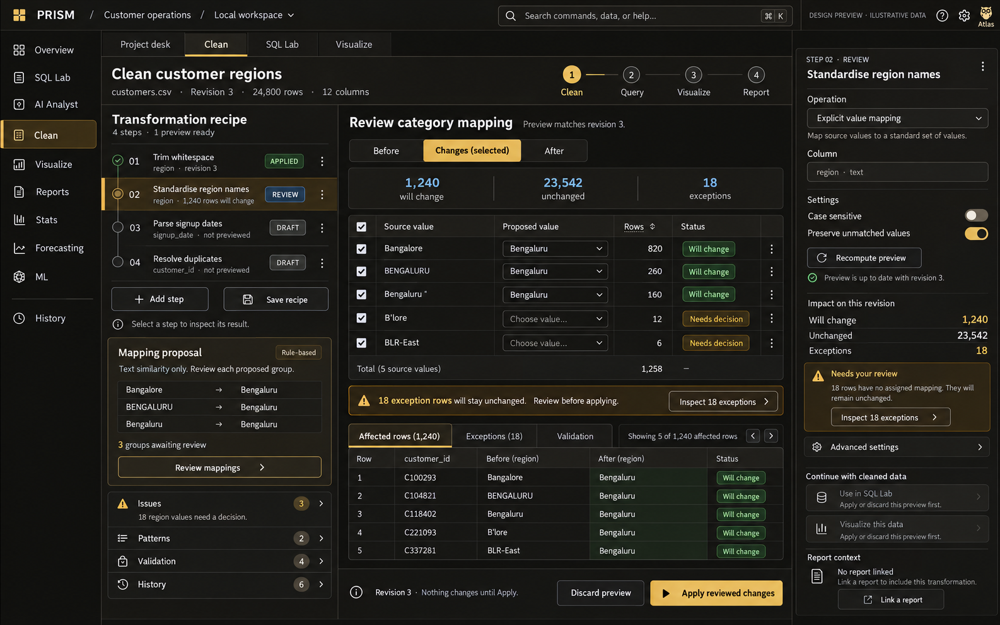
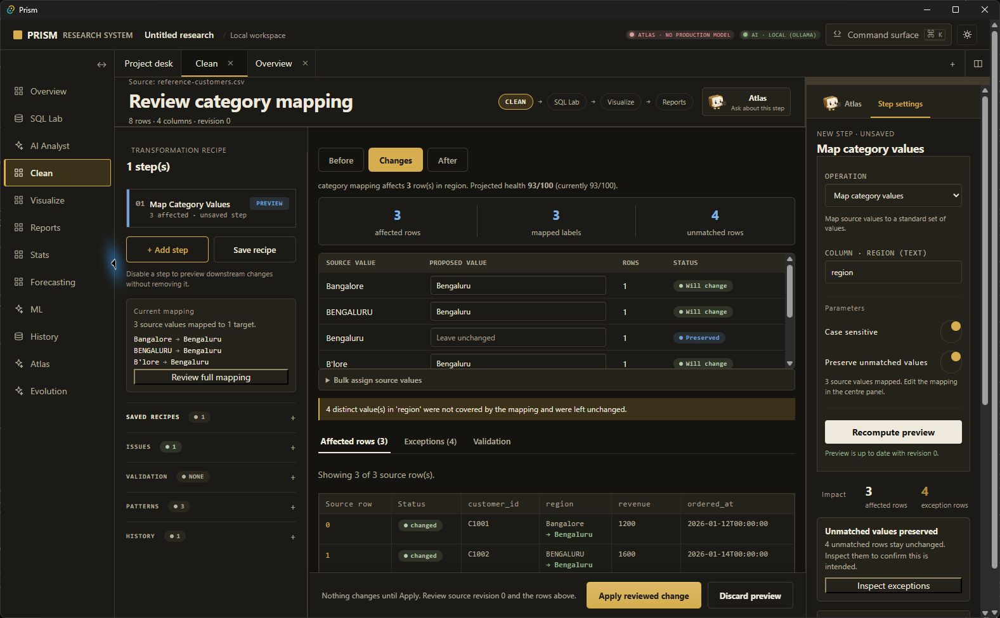
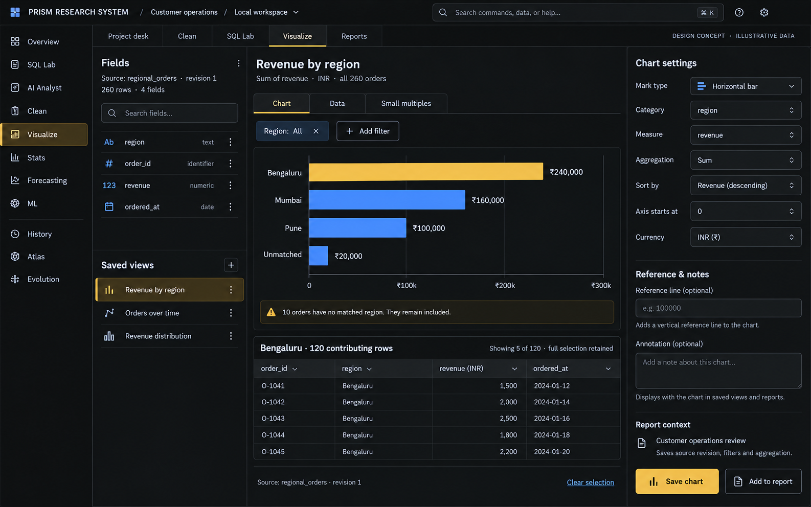
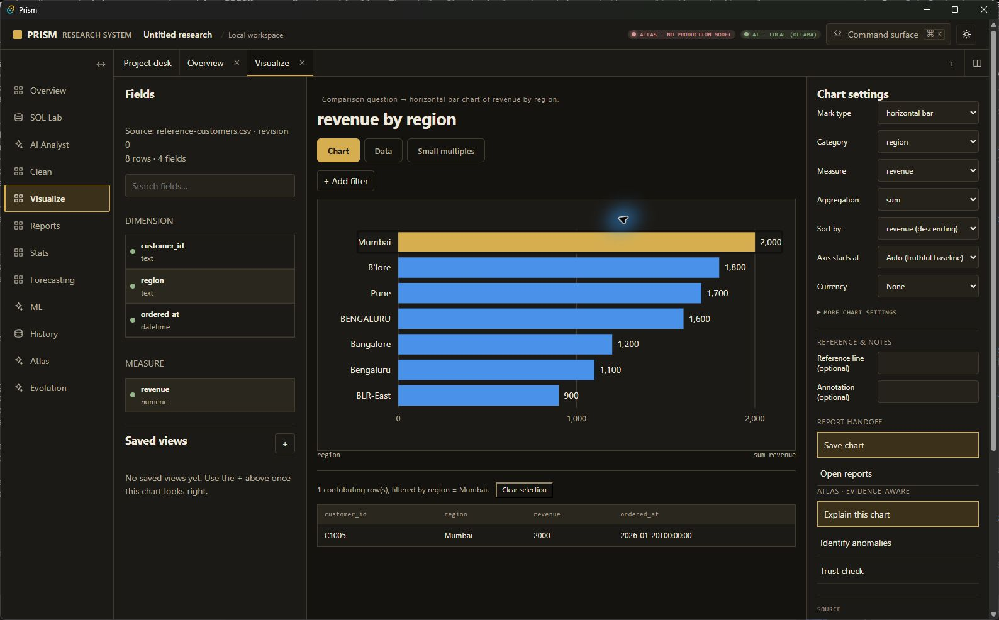
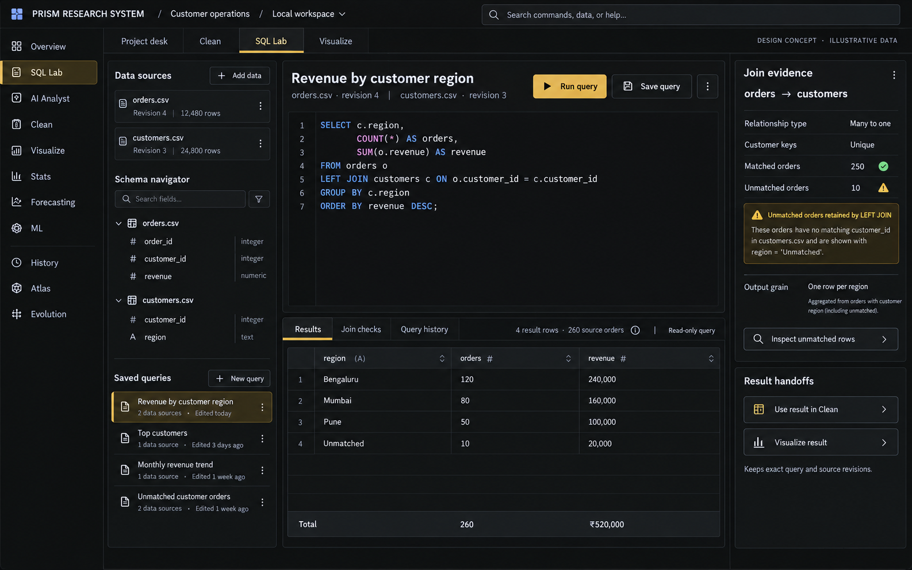
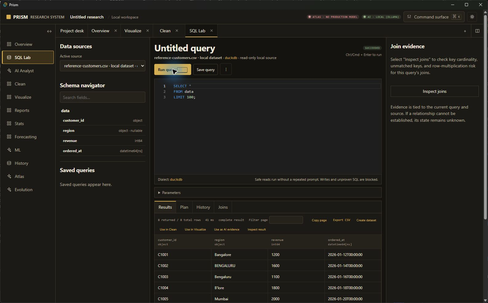

# Native workspace continuation — 2026-10-13

Starting feature SHA: `557cd37a13f5af04b7fdfe27d6ff2742f7715b1b`. This is a continuation of the same worktree and branch. The source changes in this record remain uncommitted until the final gate and evidence review. The canonical `prism` checkout and the owner's installed data were not used.

## Native evidence against approved references

All actual captures below came from `apps/desktop-shell/src-tauri/target/release/app.exe`, launched with `PRISM_DESKTOP_DATA_DIR` and the analytical-history database URL set explicitly to `.prism/desktop-user-test-20261012`. The reference CSV contains eight rows, seven distinct nonmissing region labels, and one missing region. Three explicit mappings change three rows; four unmapped rows and one missing row remain unchanged. Source-row IDs and chart contributors are real. The illustrative counts in the references were not copied.

| Approved reference | Actual desktop capture | Observed difference |
|---|---|---|
| [Clean Step Settings at 1586×992](references/05-clean-workspace-substantial-panels.png) | [Clean mapping review at 1577×975](evidence/native-codex-20261013/clean-final-mapping-review-1577x975.png) | Three-pane composition and palette are present. The actual recipe contains one reviewed step, the title is a generic review title, the selected step is much less emphatic, the mapping grid has fewer visible rows, and the affected-row sample shows only two rows before the footer. The inspector has more vertical form space and less report context than the reference. The 30-pixel Windows title bar also reduces content height at a matched outer-window size. |
| [Clean with Atlas at 1586×992](references/01-data-tile-atlas-in-clean.png) | [Native Clean with Atlas on the owner's wide display](evidence/native-codex-20261013/clean-atlas-after-3440x1392.png) | The layered data-tile character renders, but the native dock is text-heavy and the populated recipe/preview composition in the reference is not reproduced in this empty screenshot. The old dock stretched a single pending/result card into unused vertical space; CSS now keeps conversation items content-sized, pending a new native capture from the rebuilt executable. |
| [Visualize at 1586×992](../clean-pattern-review-v1/references/visualize-concept.png) | [Horizontal chart and selected source row at 1588×986](evidence/native-codex-20261013/visualize-horizontal-rows-1588x986.png) | The actual chart has seven real regions, visible 0/1,000/2,000 ticks and value labels. Selecting Mumbai shows its exact contributing row. The reference has a taller result region and different typography, field-card density and saved-view treatment. Actual source is eight rows instead of the reference's illustrative dataset. |
| [SQL Lab at 1586×992](../clean-pattern-review-v1/references/sql-lab-concept.png) | [Native SQL result at 1588×986](evidence/native-codex-20261013/sql-results-1588x986.png) | Source/schema, editor, results and inspector occupy the correct regions. This real single-source query has no join evidence or saved queries, so the populated two-source inspector in the reference is not reproduced here. The editor/result vertical split leaves only the first result rows visible without scrolling. The actual grid reports 8 returned / 8 total rows for the selected fixture. |

| Clean reference | Native Clean (same eight-row fixture as the native before capture) |
|---|---|
|  |  |

| Visualize reference | Native Visualize with selected contributing row |
|---|---|
|  |  |

| SQL Lab reference | Native SQL Lab with executed query |
|---|---|
|  |  |

The [native before capture at 1368×832](evidence/native-codex-20261013/clean-before-1368x832.png) and [native after capture at 1368×832](evidence/native-codex-20261013/clean-atlas-after-1368x832.png) are at the same outer-window size but use different data states, so they show changed chrome and Atlas presentation, not a controlled pixel-diff of identical content. The near-reference Clean pair above uses the same eight-row fixture. The current images are evidence of progress, **not visual acceptance**. A final native rebuild and same-state captures are still required.

## Connected behavior and runtime findings

- In the native app, an explicit category mapping preview showed three affected source rows, four unmatched rows, and one missing value. Apply advanced the selected source from revision 0 to revision 1. SQL Lab then returned eight rows from that selected revision, including the three mapped Bengaluru values, and the SQL result opened in Visualize with its own result-source identity.
- The native Visualize chart now rejects identifier-like numeric auto measures and displays category labels, numeric ticks and values. Horizontal bars retain real mark selection and source-row inspection. [Selected-row capture](evidence/native-codex-20261013/visualize-horizontal-rows-1588x986.png).
- A real local Ollama request in the desktop selected an installed model and returned an explanation. That answer claimed both that there were no missing values and that `region` was 12.5% missing. A new server-side check rejects this observed contradiction and exposes the actual source profile in expandable evidence. The general risk of other unsupported model claims remains; model text is not treated as a verified calculation.
- A full SQLite browser run found an open recipe overflow menu intercepting Save recipe. The menu now closes and returns keyboard focus to its summary after actions. The connected Clean → SQL → Visualize → Reports test also follows the named-recipe save interaction. The targeted test passed after these fixes. Failed attempts remain in `.prism/codex-live-sqlite-20261013.log` and `.prism/codex-live-targeted{,2,3}-20261013.log`.
- A genuine packaged-app stop/start on the isolated user-test directory previously retained the dataset fingerprint and saved recipe. An incompatible saved recipe was refused against the eight-row fixture. [Native incompatible-recipe capture](evidence/native-codex-20261013/restart-saved-recipe-incompatible-1368x832.png). Active dataset selection was not reliably restored after restart; reopening the exact fixture was necessary.

## Current gates

At this source checkpoint, the focused Clean web unit file passed 31 tests; the focused workspace-proposal API file passed 15 tests; the corrected connected live browser test passed once. The full SQLite live rerun, full MySQL live run, final web/Python/static gates, desktop rebuild, and exact-SHA CI are still in progress. Earlier broad results must be rerun after the final source changes before any release claim.

## Open acceptance gaps

The Clean reference's four-step populated progression and its exact panel density are not yet demonstrated in the final packaged app. The Atlas preview-check card, full cleaning-plan review composition, light/narrow native captures, same-state final native comparisons, and the continuous real-model workflow through report recovery remain open. These gaps prevent a release/tag claim even if automated gates pass. The detached desktop automation concept remains deferred by design.
